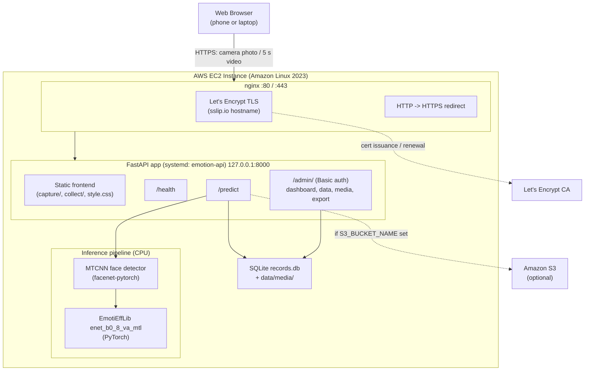

# Facial Emotion Recognition — Architecture & Solution Overview

## Architecture Diagram

## One-Page Write-Up

### Goal
A self-hosted, browser-based tool that records a participant's face (photo or 5-second video),
predicts their emotion, valence, and arousal, and stores every capture against the participant so
results can be exported for analysis. Everything runs on a single AWS EC2 instance; any phone or
laptop browser is the client.

### Components

**1. Inference backend (FastAPI, [backend/emotion_api.py](backend/emotion_api.py))**
- `POST /predict` accepts an image or a short (≤5 s) video plus participant fields (`name`, `age`,
  `diet`, optional `subject_id`).
- Faces are located with an MTCNN detector (`facenet-pytorch`, CPU) and cropped; detections below
  0.90 probability are discarded.
- Each face is scored by EmotiEffLib's pretrained multitask model `enet_b0_8_va_mtl`
  (EfficientNet-B0, trained on AffectNet). Its 10 outputs are 8 emotion logits — softmaxed into
  probabilities — plus valence and arousal ([backend/infer_emotion_va.py](backend/infer_emotion_va.py)).
  The weights are downloaded once by the `emotiefflib` package to `~/.emotiefflib/`.
- For video, one frame every 0.2 s of video time is sampled across the first 5 s of the clip,
  using each frame's own timestamp (so slow CPU detection never shortens it). Per-frame results (face crop, timestamp,
  emotion, confidence, valence, arousal) are returned in `frames[]`; the final emotion is the
  argmax of the averaged probabilities, and a `logic` string explains the aggregation.
- `GET /health` is a liveness check. Everything that exposes stored data is under `/admin/` and
  needs HTTP Basic auth (`ADMIN_PASSWORD`): the research dashboard, `/admin/data` (JSON),
  `/admin/media/...` (stored captures) and `/admin/export` (Excel). uvicorn listens on
  `127.0.0.1`, so it is reachable only through nginx's HTTPS.

**2. Storage**
- Every original upload is written to `backend/data/media/<subject_id>/<capture_id>.<ext>` and its
  metadata and prediction to `backend/data/records.db` (SQLite). See
  [backend/SUBJECT_DATA_STORAGE.md](backend/SUBJECT_DATA_STORAGE.md).
- If `S3_BUCKET_NAME` is set, the upload is also copied to S3.

**3. Browser front end ([backend/static/](backend/static))**
- Dependency-free HTML/CSS/JS served by FastAPI via `StaticFiles` — no build step.
- Guided three-step flow: **Participant** (name, age, diet; generates a stable subject ID that is
  kept when details are edited) → **Capture** (camera preview with face guide, Photo or 5-second
  video) → **Results** (emotion, confidence, valence/arousal mood map, per-frame strip for video).
- A second page, `/collect/` ([backend/static/collect/](backend/static/collect)), is for blind
  data collection. It posts to `POST /collect/submit`, which stores the capture and returns without
  any result. Analysis runs in a single background worker that updates the stored row, so the
  participant never sees an emotion and the next participant can start immediately.
- Captures from the current session are listed and can be reopened; the research dashboard
  ([backend/admin/](backend/admin)) is linked in the header. Light and dark themes follow the OS setting.

**4. Python environment**
- A virtualenv (`backend/.venv`, Python 3.9) with `torch`/`torchvision` from PyTorch's CPU-only
  wheel index, avoiding ~4 GB of unused CUDA libraries.

**5. Process management**
- The API runs as the systemd unit `emotion-api.service` (`User=ec2-user`), so it starts on boot
  and restarts on failure.

**6. Reverse proxy & HTTPS (nginx)**
- nginx listens on 80/443 and proxies to the FastAPI app on `127.0.0.1:8000`.
- Browser camera access (`getUserMedia`) requires a secure context, so the site is served over
  HTTPS with a Let's Encrypt certificate for `18.61.179.93.sslip.io` (sslip.io maps that hostname
  to the instance IP, so no domain purchase is needed). HTTP redirects to HTTPS and the certificate
  auto-renews via `certbot-renew.timer`.
- Port 8000 speaks plain HTTP only; users should always open the `https://…sslip.io/` URL.

### Request Flow (video capture)
1. The browser asks for camera permission and records 5 seconds via `MediaRecorder`.
2. The clip and participant fields are POSTed to `https://18.61.179.93.sslip.io/predict`.
3. nginx terminates TLS and forwards the request to FastAPI on port 8000.
4. FastAPI samples frames, detects/crops faces, scores each with the model, and stores the capture.
5. The JSON response (aggregate result + per-frame breakdown + logic) returns to the browser, which
   shows the results view.

### Key Design Decisions
- **Pretrained model, CPU-only inference**: no training happens on the server; the instance has
  no GPU, so all inference uses `device="cpu"` and CPU wheels.
- **Local storage first, S3 optional**: captures are always kept locally (SQLite + media folder) so
  the Excel export works without AWS credentials; S3 is an optional copy.
- **sslip.io + Let's Encrypt** instead of a self-signed certificate: a publicly trusted HTTPS
  endpoint (required for camera access on real devices) without owning a domain name.
- **Single-origin deployment**: the frontend is served by the same FastAPI process as the API, so
  no CORS configuration is needed.
