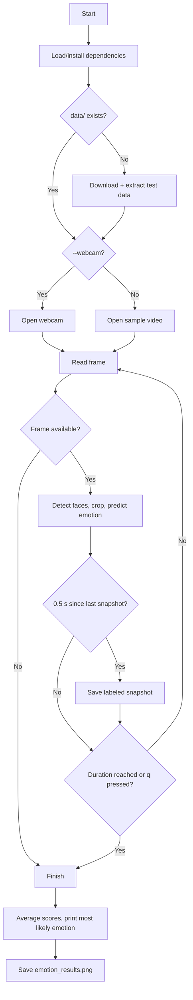

# Facial Emotion Recognition

A browser-based tool that records a participant's face, as a photo or a 5-second video, and
predicts their **emotion**, **valence** (unpleasant → pleasant) and **arousal** (calm → energized).
Every capture is stored against the participant and can be analyzed and exported from a
password-protected research dashboard.

- **Frontend:** plain HTML/CSS/JS in [backend/static/](backend/static), served by the backend. No
  build step.
- **Backend:** FastAPI in [backend/](backend). It uses MTCNN to find faces and EmotiEffLib's
  pretrained `enet_b0_8_va_mtl` model to score them, on CPU.
- **Live deployment:** capture app at https://18.61.179.93.sslip.io/capture/, data collection at https://18.61.179.93.sslip.io/collect/ (the bare address redirects to `/collect/`). AWS EC2 + nginx + Let's Encrypt.

See [ARCHITECTURE.md](ARCHITECTURE.md) for how the pieces fit together.

---

## Project layout

```text
.
├── backend/
│   ├── emotion_api.py           # FastAPI app: /predict, /collect/submit, /health, /admin (dashboard, data, media, export), static site
│   ├── infer_emotion_va.py      # Model wrapper: emotion probabilities + valence/arousal
│   ├── static/                  # Web frontend (capture/ app, collect/ app, shared style.css)
│   │   └── collect/             # Blind data-collection variant, served at /collect/
│   ├── admin/                   # Password-protected research dashboard, served at /admin/
│   ├── requirements.txt
│   ├── requirements-lock.txt
│   ├── README.md                # API details, storage, env vars
│   └── SUBJECT_DATA_STORAGE.md  # Database schema and media layout
├── predict_emotions_on_video.py # Standalone command-line demo (see bottom of this file)
├── requirements.txt             # Dependencies for the standalone demo
├── ARCHITECTURE.md
└── PACKAGE_VERSIONS.txt
```

`backend/data/` (database and captured media) and `backend/certs/` are created locally and are
ignored by git.

---

## Run locally

```bash
cd backend
python3 -m venv .venv
source .venv/bin/activate
pip install torch torchvision --index-url https://download.pytorch.org/whl/cpu   # CPU-only wheels
pip install -r requirements.txt
uvicorn emotion_api:app --host 0.0.0.0 --port 8000
```

Open http://localhost:8000/. Browsers allow camera access on `localhost` without HTTPS; from any
other address the page must be served over HTTPS (see below).

The model weights (`enet_b0_8_va_mtl.pt`, ~16 MB) are downloaded automatically to `~/.emotiefflib/`
on the first prediction.

### Using the app

1. **Participant:** enter name, age and diet, then *Save & continue*.
2. **Capture:** turn on the camera, pick *Photo* or *5-sec video*, and press the shutter.
3. **Results:** emotion, confidence, a valence/arousal mood map and, for video, a frame-by-frame
   breakdown. *Capture again* or start a *New participant*.

*Research dashboard* (top right) opens the admin dashboard described below.

### Blind data collection (`/collect/`)

A second version of the capture app for studies where participants must not see their result.
Open `/collect/` instead of `/`:

1. The participant enters name, age and diet and takes a photo or 5-second video.
2. The page says *Thank you* and clears the form for the next participant right away. No emotion
   is shown, and the server's response doesn't include one.
3. The capture is uploaded in the background (retried automatically if the network drops; keep the
   tab open while the panel shows captures waiting to upload).
4. The server stores the media and a `pending` row immediately, then analyzes captures one at a
   time in a background worker and fills in the result. Captures still pending when the service
   restarts are re-queued on startup.

Blind captures appear in the dashboard and Excel export like any other. The export's
*Capture Mode* (`interactive` / `blind`) and *Analysis Status* (`pending` / `done` / `failed`)
columns tell them apart. The original app at `/` is unchanged.

### Research dashboard

`/admin/` is a password-protected dashboard for analyzing everything collected. Set the password
before starting the server (the dashboard returns 503 until it is set):

```bash
export ADMIN_PASSWORD='choose-a-strong-password'   # username defaults to "admin"; override with ADMIN_USERNAME
```

- **Filters:** date range, media type, diet, age range, emotion, minimum confidence, participant,
  "face detected only". Every view and export follows the filters.
- **Overview:** summary figures, emotion distribution, valence × arousal mood map, captures per day.
- **Explorer:** scatter any two variables (valence, arousal, confidence, age, date, time of day,
  per-video variability) per capture or per video frame, with Pearson r, p and a trend line.
- **Compare groups:** mean ± 95% CI by diet, media type, age band, emotion or participant, with
  Welch's t-test (2 groups) or one-way ANOVA (3+), plus the emotion mix per group.
- **Captures / Participants:** sortable tables. Click a capture to replay its photo or video and see
  its frame-by-frame valence and arousal.
- **Exports:** *Captures CSV* and *Frames CSV* contain only the filtered rows; *Excel (all)*
  downloads every capture.

Stored photos and videos (`/admin/media/...`) and the Excel export (`/admin/export`) require the
same login. The old `/media/...` and `/export` URLs redirect there.
- **Exclude from analysis:** hides a test or bad capture from every view. It is stored in that
  browser only and never changes the database.

The p-values are exploratory: repeated captures of one participant, and frames of one clip, are not
independent observations.

---

## Deploy on AWS EC2 (current setup)

1. Clone the repo on the instance and create the environment as in *Run locally*.
2. Run the API as a systemd service so it survives reboots:

   ```ini
   # /etc/systemd/system/emotion-api.service
   [Unit]
   Description=Emotion Recognition FastAPI backend
   After=network.target

   [Service]
   User=ec2-user
   WorkingDirectory=/home/ec2-user/emotion-gen/backend
   ExecStart=/home/ec2-user/emotion-gen/backend/.venv/bin/uvicorn emotion_api:app --host 127.0.0.1 --port 8000
   EnvironmentFile=/home/ec2-user/emotion-gen/backend/.env   # ADMIN_USERNAME=admin, ADMIN_PASSWORD=...
   Restart=always

   [Install]
   WantedBy=multi-user.target
   ```

   ```bash
   sudo systemctl daemon-reload
   sudo systemctl enable --now emotion-api
   ```

3. Put nginx in front on ports 80/443 with `proxy_pass http://127.0.0.1:8000;`, and get a
   certificate with certbot for `<public-ip>.sslip.io`. Cameras only work on HTTPS pages. uvicorn
   listens on `127.0.0.1` only, so the app (and the admin password) is reachable only through
   nginx's HTTPS.
4. Open ports 80 and 443 in the instance's security group.
5. Check it works: `https://<public-ip>.sslip.io/health` should return `{"status":"ok"}`.

`backend/.env` is ignored by git; keep it readable only by `ec2-user` (`chmod 600`).

Optional environment variables (`S3_BUCKET_NAME`, `AWS_REGION`, `S3_CAPTURE_PREFIX`) enable copying
captures to S3. See [backend/README.md](backend/README.md).

### Redeploy after changes

```bash
git pull
source backend/.venv/bin/activate && pip install -r backend/requirements.txt   # only if dependencies changed
sudo systemctl restart emotion-api
```

Frontend-only changes (`backend/static/`, `backend/admin/`) take effect without a restart; reload the page.
Backend changes (`emotion_api.py`, e.g. the `/collect/submit` endpoint) need the restart.

### Troubleshooting

| Symptom | Fix |
|---|---|
| "This site can't provide a secure connection" or `:8000` doesn't load | Port 8000 is local-only. Use `https://<public-ip>.sslip.io/` (no port). |
| Opened the bare IP (`http://18.61.179.93/`) | nginx redirects any other host name to `https://18.61.179.93.sslip.io` (same path). `https://<ip>/` shows a certificate warning first, because Let's Encrypt (via certbot 2.x) can't issue certificates for bare IPs. |
| `/admin/` returns 503 | `ADMIN_PASSWORD` isn't set: add it to `backend/.env` and restart the service. |
| Camera won't start / "requires https" | Open the site over HTTPS (or `localhost`), and allow camera access in the browser's site settings. |
| "No face found" | Face the camera in good light, move closer, keep one face inside the oval. |
| Site down | `sudo systemctl status emotion-api` and `journalctl -u emotion-api -n 100`; restart with `sudo systemctl restart emotion-api`. |

---

## Standalone command-line demo

`predict_emotions_on_video.py` is a separate script that runs the emotion model on a sample video or
your webcam and saves a collage of labeled snapshots. It does not use the web app.

```bash
python3 -m venv .venv && source .venv/bin/activate
pip install -r requirements.txt

python predict_emotions_on_video.py                         # sample video (downloads test data into data/ if missing)
python predict_emotions_on_video.py --webcam                # webcam, press q to stop
python predict_emotions_on_video.py --webcam --duration 10  # webcam for 10 seconds
```

For each frame it detects faces, crops them and scores emotions. Every 0.5 s it saves a face
snapshot labeled with the time and the predicted emotion. At the end it prints the most likely
emotion averaged over all frames and writes everything to **`emotion_results.png`**.



If it's slow, close other heavy apps; webcam mode is CPU-bound.
